# Documentación: CRUD Spring Boot - JavaScript - MySQL

## Requisitos y Tecnologías
* **IDE:** NetBeans / IntelliJ IDEA / VS Code
* **Entorno / Servidor:** XAMPP, Postman
* **Backend:** Spring Boot, Java 21, Spring Data JPA, Maven, Lombok
* **Base de Datos:** MySQL
* **Frontend:** HTML5, CSS3, JavaScript (ES6+), Bootstrap 4.5.2

---

## Introducción
Esta aplicación consiste en un **CRUD Full Stack** simple con arquitectura cliente-servidor:
* **Backend:** API RESTful desarrollada con Spring Boot y base de datos MySQL, organizada en capas (Controller, Service, Repository, Entity, DTO).
* **Frontend:** Aplicación web cliente utilizando HTML, CSS, JavaScript e integración con la API mediante Fetch API.


## Resumen de Tareas de Desarrollo

| Tarea | Descripción |
|---|---|
| **TAREA 1** | Crear la base de datos en MySQL y la estructura de directorios |
| **TAREA 2** | Generar el proyecto inicial en Spring Initializr |
| **TAREA 3** | Verificar despliegue inicial del backend |
| **TAREA 4** | Crear la estructura de paquetes/capas en Java |
| **TAREA 5** | Configurar `application.properties` para MySQL |
| **TAREA 6** | Crear la entidad `Product` con anotaciones JPA y Lombok |
| **TAREA 7** | Crear la interfaz `ProductRepository` |
| **TAREA 8** | Implementar `ProductService` y `ProductServiceImpl` |
| **TAREA 9** | Crear los endpoints en `ProductController` |
| **TAREA 10**| Probar los endpoints REST con Postman |

---

## Paso a Paso: Desarrollo del Backend

### TAREA 1: Base de datos y Estructura de Proyecto

1. **Crear la base de datos MySQL:**

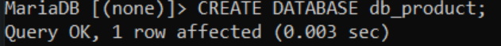

2. **Crear la estructura de carpetas local:**


---

### TAREA 2: Configuración en Spring Initializr

Acceder a [start.spring.io](https://start.spring.io/) con los siguientes datos:
* **Project:** Maven
* **Language:** Java
* **Spring Boot:** 3.2.x (o superior)
* **Group:** `net.laboratorioderedes`
* **Artifact / Name:** `api-product`
* **Package name:** `net.laboratorioderedes.product`
* **Packaging:** Jar
* **Java:** 21

**Dependencias agregadas:**
1. **Spring Boot DevTools**
2. **Lombok**
3. **Spring Web**
4. **Spring Data JPA**
5. **MySQL Driver**


---

### TAREA 3: Verificación de Despliegue Inicial

1. Para probar la ejecución sin configurar aún la base de datos, comentar temporalmente la dependencia `spring-boot-starter-data-jpa` en el `pom.xml`.
2. Iniciar la aplicación y acceder a `http://localhost:8080` para verificar la pantalla `Whitelabel Error Page` (confirmación de que Tomcat está activo).

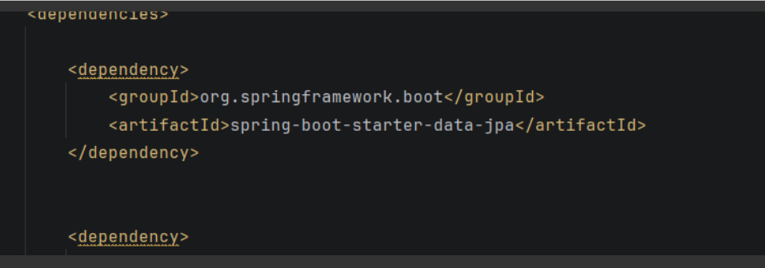


---

### TAREA 4: Estructura de Capas

Crear los siguientes paquetes dentro de `net.laboratorioderedes.product`:
* `controller`
* `entity`
* `repository`
* `service`

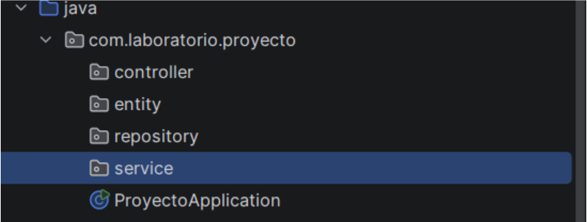

---

### TAREA 5: Configuración de `application.properties`


---

### TAREA 6: Creación de la Entidad `Product`

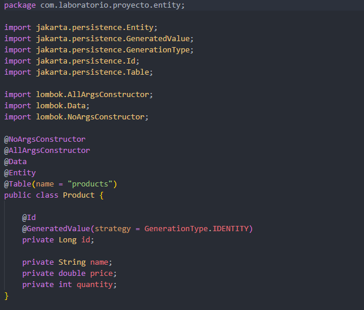

### TAREA 7: Creación del Repositorio

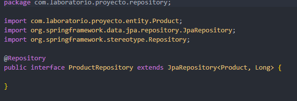


#### Verificación en la Base de Datos
Al ejecutar el proyecto con MySQL encendido (XAMPP), Hibernate creará automáticamente la tabla `products`. Podemos verificarlo desde la consola MariaDB/MySQL:

```sql
MariaDB [db_product]> SHOW TABLES;
MariaDB [db_product]> DESCRIBE products;
```


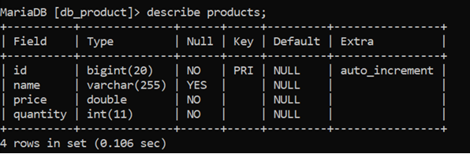

---

### TAREA 8: Implementación de la Capa Service

#### 1. Interfaz de Servicio


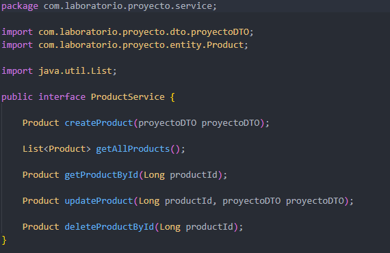

#### 2. Implementación del Servicio
Ubicación: `net.laboratorioderedes.product.service.ProductServiceImpl.java`

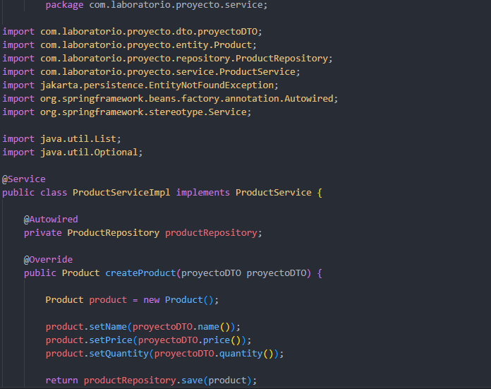
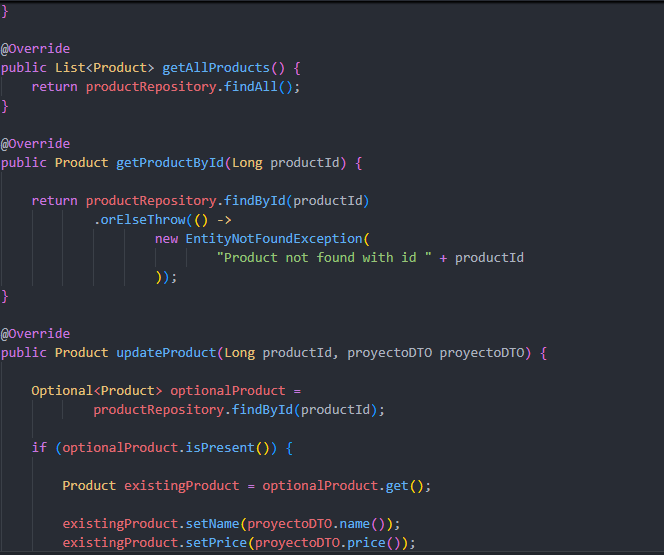
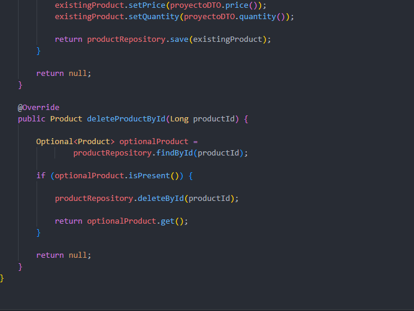

---

### TAREA 9: Controlador REST

Ubicación: `net.laboratorioderedes.product.controller.ProductController.java`

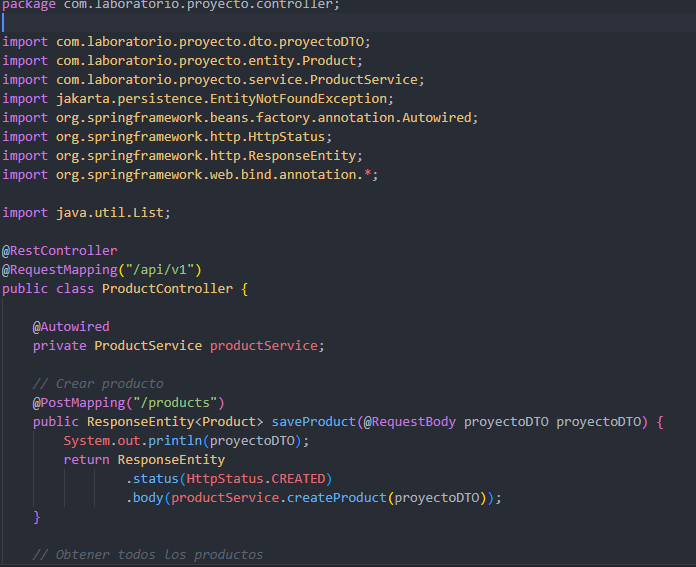

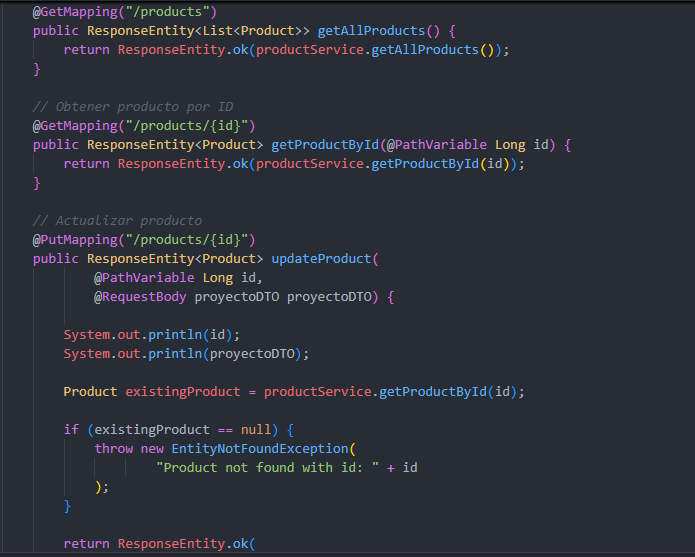

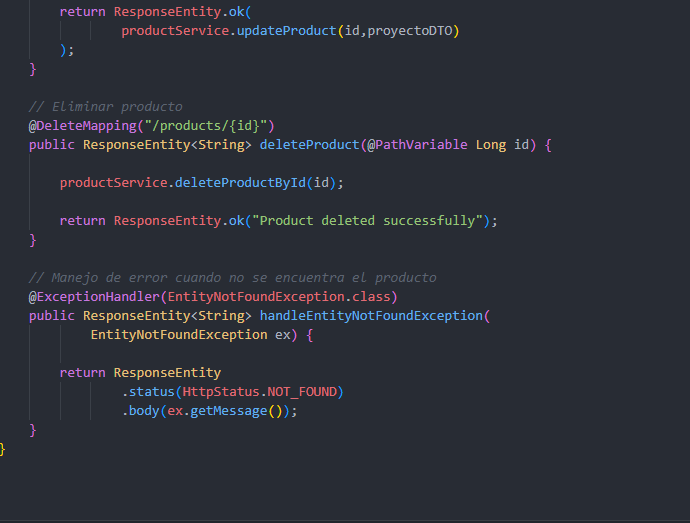

---

### TAREA 10: Pruebas de Endpoints con Postman

1. **CREATE metodo para ingresar los datos**
  

2. **READ ALL lee lo de post**

  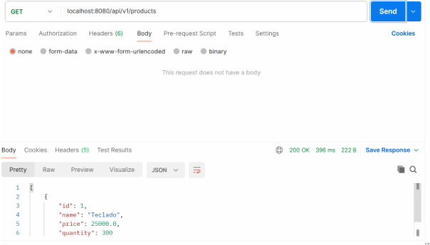

3. **READ BY ID muestra por id y te muestra lo que pusiste en post**

  

4. **UPDATE  el put actualiza “update”**

  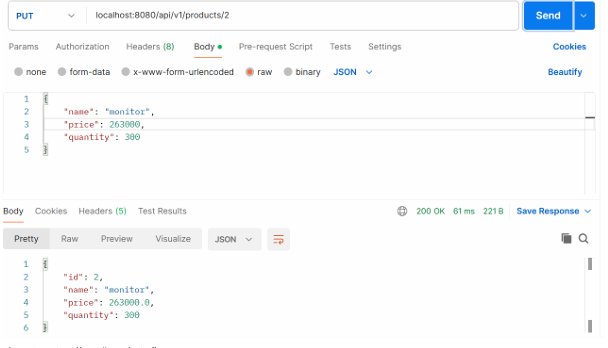

5. **DELETE borra el producto que ingresaste por id**
   
  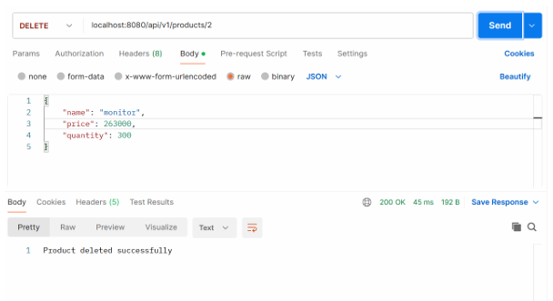

---

# Creación y Validación de DTOs en Spring Boot

En el desarrollo de APIs REST en Spring Boot, los **DTO (Data Transfer Objects)** son fundamentales para transferir información entre el cliente y el servidor sin exponer directamente las entidades de la base de datos.

---

## 1. Estructura de Paquetes del Proyecto

Ubicamos el DTO dentro del paquete correspondiente (`com.laboratorio.proyecto.dto`) dentro de la arquitectura de capas estándar:

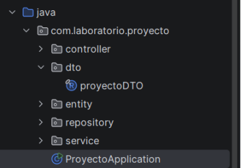

## 2. Código del `proyectoDTO`

Utilizamos un `record` de Java junto con la especificación `jakarta.validation.constraints` para validar que los datos recibidos en las peticiones HTTP cumplan con las reglas de negocio antes de ser procesados.

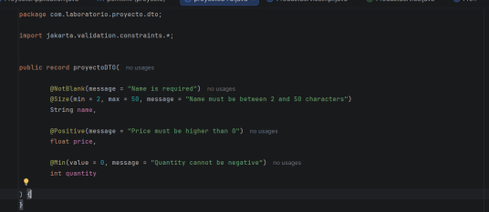